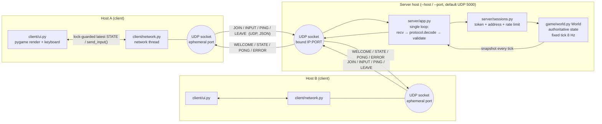
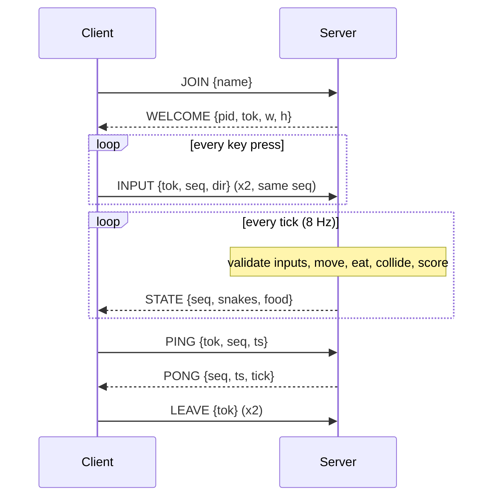

# SnakeNet Architecture



## Sequence: join and play



## Responsibilities

| Process | Does | Never does |
|---|---|---|
| **Server** (`snakenet/server/`, `snakenet/game/`) | Bind UDP socket; validate every datagram; own sessions; run the fixed-step simulation; decide movement, food, growth, collisions, deaths, scores; broadcast snapshots; expire idle sessions | Trust client positions/scores; block on any client |
| **Client** (`snakenet/client/`) | Own UDP socket; JOIN with retry; send validated direction inputs; receive snapshots on a network thread; drop stale ones; render; show connection status; leave cleanly | Simulate the game or send state |

## Layering and module map (dependencies point downward only)

```
 server/__main__.py   client/__main__.py   client/bot.py        entry points (CLI, argv parsing)
        |                    |                  |
 server/app.py         client/ui.py  ──►  client/network.py      application / adapters (UDP I/O, pygame)
        |    \                                   |
 server/sessions.py  server/throttle.py          |               per-player state, abuse limiters
        |                                         |
        └──────────►  protocol/  ◄───────────────┘               wire contract: schemas, validation, codec
        └──────────►  game/      (server only; client uses decode_body to render)   pure domain, no I/O
                      config.py                                  settings dataclasses
```

| Package | Single responsibility | Knows about |
|---|---|---|
| `protocol/` | `limits` constants, `errors` codes, `validators`, `schemas` (message catalogue), `codec` (bytes ⇄ validated dict) | nothing else |
| `game/` | Rules and simulation (`world.py`); deterministic, testable without sockets | nothing else |
| `server/sessions.py` | Session identity, token-bucket input limiter, input sequence check | nothing else |
| `server/throttle.py` | Per-address ERROR budget, de-duplicated logging | nothing else |
| `server/app.py` | UDP socket, receive/dispatch, tick loop, broadcast | protocol, game, sessions, throttle |
| `client/network.py` | Client socket + thread + connection state machine (no pygame) | protocol |
| `client/ui.py`, `client/bot.py` | Presentation / autopilot on top of `NetClient` | client.network, game (decode only) |

## Concurrency model

* **Server:** one thread. No shared mutable state, no locks. Socket reads use a timeout equal to the time until the next tick, so the loop wakes for either a datagram or a tick. At most 256 datagrams are drained per iteration, so a flood cannot starve the simulation.
* **Client:** the UI thread renders; a network thread receives. They share only the latest validated snapshot and status, replaced under one `threading.Lock`; the UI copies it out. Sequence counters are touched under the same lock.
