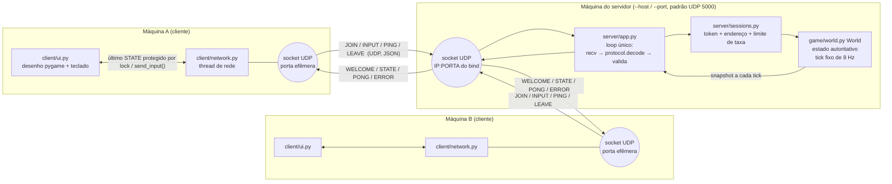
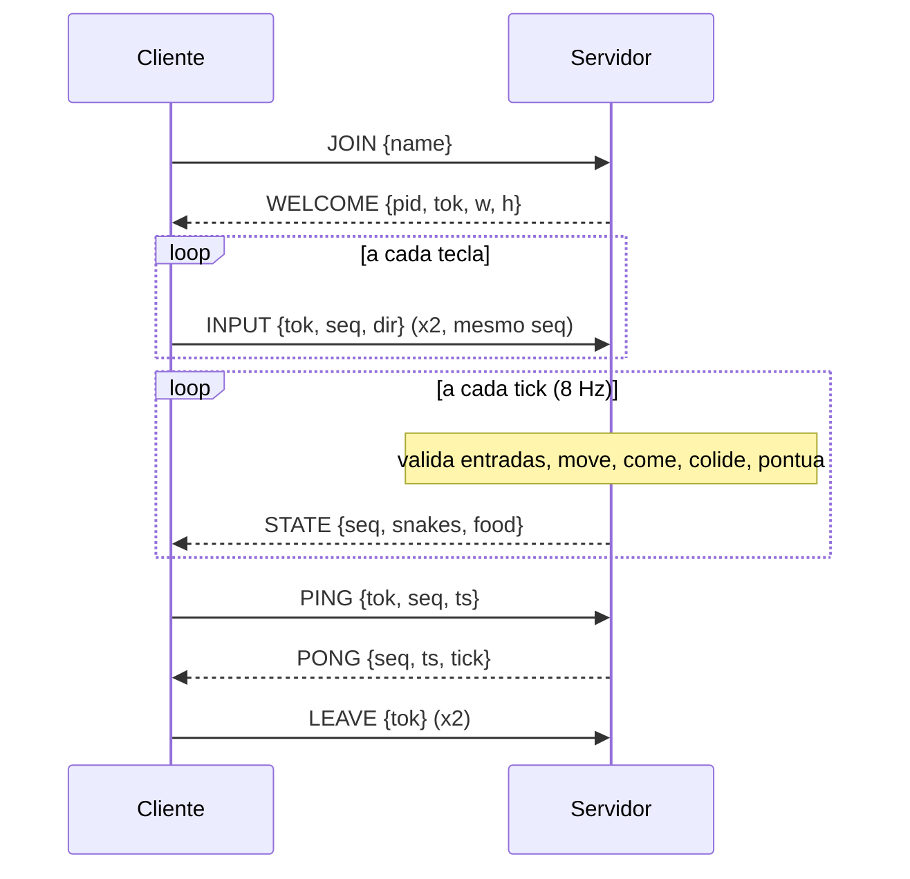

# Arquitetura do SnakeNet



## Sequência: entrar e jogar



## Responsabilidades

| Processo | Faz | Nunca faz |
|---|---|---|
| **Servidor** (`snakenet/server/`, `snakenet/game/`) | Faz o bind do socket UDP; valida todo datagrama; é dono das sessões; roda a simulação em passo fixo; decide movimento, comida, crescimento, colisões, mortes e pontos; envia os snapshots; expira sessões inativas | Confiar em posição/pontos enviados pelo cliente; travar esperando um cliente |
| **Cliente** (`snakenet/client/`) | Tem socket UDP próprio; faz JOIN com retentativa; envia direções validadas; recebe snapshots em uma thread de rede; descarta os antigos; desenha; mostra o estado da conexão; sai de forma limpa | Simular o jogo ou enviar estado |

## Camadas e mapa de módulos (as dependências só apontam para baixo)

```
 server/__main__.py   client/__main__.py   client/bot.py        pontos de entrada (CLI, argumentos)
        |                    |                  |
 server/app.py         client/ui.py  ──►  client/network.py      aplicação / adaptadores (E/S UDP, pygame)
        |    \                                   |
 server/sessions.py  server/throttle.py          |               estado por jogador, limitadores de abuso
        |                                         |
        └──────────►  protocol/  ◄───────────────┘               contrato na rede: schemas, validação, codec
        └──────────►  game/      (só o servidor; o cliente usa decode_body para desenhar)   domínio puro, sem E/S
                      config.py                                  dataclasses de configuração
```

| Pacote | Responsabilidade única | Conhece |
|---|---|---|
| `protocol/` | constantes de `limits`, códigos de `errors`, `validators`, `schemas` (catálogo de mensagens), `codec` (bytes ⇄ dict validado) | nada além de si |
| `game/` | Regras e simulação (`world.py`); determinístico, testável sem sockets | nada além de si |
| `server/sessions.py` | Identidade da sessão, limitador token bucket de entradas, checagem de sequência | nada além de si |
| `server/throttle.py` | Orçamento de ERROR por endereço, log sem repetição | nada além de si |
| `server/app.py` | Socket UDP, recepção/despacho, loop de ticks, broadcast | protocol, game, sessions, throttle |
| `client/network.py` | Socket + thread + máquina de estados da conexão (sem pygame) | protocol |
| `client/ui.py`, `client/bot.py` | Apresentação / piloto automático sobre o `NetClient` | client.network, game (só decodificação) |

## Modelo de concorrência

* **Servidor:** uma única thread. Sem estado mutável compartilhado e sem locks. A leitura do socket usa um timeout igual ao tempo até o próximo tick, então o loop acorda tanto por um datagrama quanto por um tick. No máximo 256 datagramas são consumidos por iteração, de modo que um flood não consegue travar a simulação.
* **Cliente:** a thread da UI desenha; uma thread de rede recebe. Elas compartilham apenas o último snapshot validado e o status, trocados sob um único `threading.Lock`; a UI copia o valor. Os contadores de sequência também são usados sob o mesmo lock.
